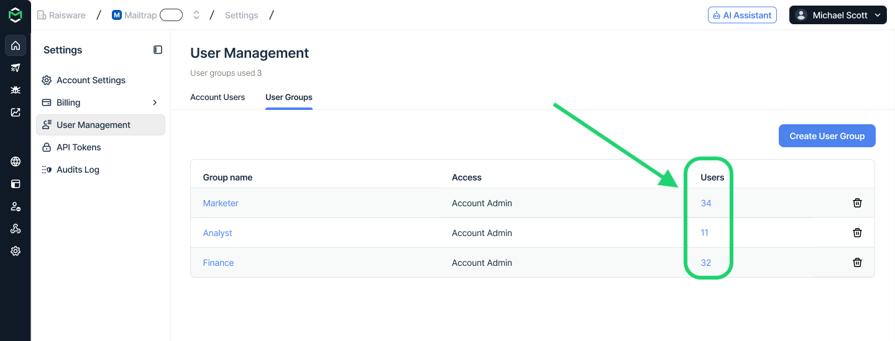

# User Groups

User Groups let you define permissions and assign them to different users. This way, instead of configuring the same access separately for each teammate, you can create a group, select its permissions, and add the people who need them.

For example, let's say you create a group for developers working with selected sandboxes or a group for teammates who need read-only access to campaigns. If you update the group’s permissions, you update the inherited access of all its members.

### Creating a user group


User groups are specific to the account where they are created. They cannot grant access to another account, organization-level settings, or billing. They are not managed from organization-level User Management.


Since there are no default user groups, Account Admins create groups as needed, and there is no limit on the number of groups.

* Go to **Account** → **User Management** → **User Groups**
* Click on **Create User Group**

<figure><figcaption></figcaption></figure>

* Enter a name, select at least one permission, and hit **Create**.

<figure><figcaption></figcaption></figure>

**Group names**:

* **Must be unique** within the account, regardless of capitalization. For example, **Developers** and **developers** cannot coexist.
* Can contain **up to 100 characters**.

A group can exist without members, so you can prepare it before assigning anyone. However, **it cannot be saved without at least one** permission.

#### User Group permissions

**A group can grant account-level permissions or access** to specific resources within the current account, such as selected projects. Review this scope carefully: an account-level grant may provide broader access than a permission for one project.


A group’s name does not determine its access. Calling a group “Developers” grants nothing by itself; its configured permissions determine what members can do.


### Assigning users to groups

A user can belong to multiple groups or have no group membership. Groups can be assigned to existing users and pending invitations, but **cannot be assigned to API tokens**.

<strong>When inviting a new member</strong>

* Open **Account** → **User Management** and start a new invitation.
* Enter the invitee’s details.
* Select one or more user groups.
* Add any additional individual permissions they need.
* Review the access and send the invitation.

<figure><figcaption></figcaption></figure>


The selected group memberships are retained when the invitation is accepted. Pending invitations are included in each group’s member count.


<strong>For an existing member</strong>

* Find the member in the **Account Users** list.

<figure><figcaption></figcaption></figure>

* Open their access settings.
* Select or remove the relevant groups.
* Review their resulting access and save.

Group permissions take effect immediately after saving.


When you save group membership, individual permissions that overlap with group permissions may be removed as redundant. If you later remove the group, that access may also disappear unless it is granted again individually or through another group.


### How permissions are combined

A member’s effective access combines:

* Permissions assigned directly to them.
* Permissions inherited from every group they belong to.

For the same resource, the **highest access level applies**. A group never reduces access granted individually or through another group.

| **Source**              | **Permission**                |
| ----------------------- | ----------------------------- |
| Individual access       | Viewer access to Project A    |
| Developers group        | Admin access to Project A     |
| Project Reviewers group | Viewer access to Project A    |
| **Effective access**    | **Admin access to Project A** |

Access remains scoped to the configured resources. Admin access to Project A does not automatically grant Admin access to Project B.

#### Understanding the member permissions form

Permissions inherited from groups appear selected and disabled. You cannot uncheck them individually because their source is a group.

To remove an inherited permission from a member, remove the group that grants it. If another assigned group also grants the permission, it remains available.

If the permission should be removed for everyone in the group, edit the group instead.

<figure><figcaption></figcaption></figure>

#### Overlapping individual permissions

Do not assume an earlier individual permission will remain as a fallback after assigning a group.

For example:

1. A member has individual Viewer access to Project A.
2. You assign a group that also grants Viewer access to Project A.
3. When saving, the overlapping individual permission may be removed as redundant.
4. If you later remove that group, the member may lose access to Project A.

### Viewing groups and members

The **User Groups** list shows each group’s:

* Name.
* Summarized access.
* Member count, including pending invitations.

Click a group’s member count to open the **Account Users** list filtered to that group.

<figure><figcaption></figcaption></figure>

You can also filter **Account Users** by one or more user groups. A member’s access summary indicates when access comes from a user group.

<figure><figcaption></figcaption></figure>

### Editing a user group

Open a group to update its name, permissions, or membership.

<figure><figcaption></figcaption></figure>

Permission changes take effect immediately for every member, including users who accept a pending invitation later.

If the group has members, changing its permissions requires confirmation. Review the changes carefully before confirming:

* Added permissions may increase access for all members.
* Removed permissions may reduce access for members who do not receive them from another source.

<figure><figcaption></figcaption></figure>

Renaming a group without changing its permissions does not require this confirmation and does not affect access or membership.

A group must retain at least one permission.

### Removing a member from a group

Removing a member from a group immediately removes the permissions inherited from it. Permissions still granted individually or through another group remain available.

Removing membership does not itself delete individual permissions. However, overlapping individual permissions may already have been removed when group membership was previously saved.

You can remove all groups from a member if they still have at least one individual permission. A member must always retain either:

* At least one individual permission, or
* Membership in at least one user group.

Removing someone from a group does not remove them from the account. If a teammate no longer needs any account access, remove them through User Management.

### Deleting a user group

Before deleting a group, the interface shows how many members will lose access inherited from it. Review the impact and confirm the deletion.

<figure><figcaption></figcaption></figure>

**Deleting a group:**

* Removes it from all members.
* Removes all permissions inherited from it.
* Preserves users and pending invitations.
* Preserves remaining individual permissions and access inherited from other groups.

Keep in mind that members retain a permission if another source still grants it. Furthermore, individual permissions previously removed as redundant are not restored by deleting the group.


Group creation, updates, deletion, and membership-related changes are recorded in the activity log, where you can review changes to shared access and group membership.


### Who can manage user groups?

* Only **Account Admins** can create, edit, or delete groups and manage their membership.
* **Project Admins** cannot assign users to groups, even if they can edit permissions for their projects.
* An **admin** can add only permissions they are allowed to grant directly.&#x20;
* A group cannot grant **Account Owner** access, and an Account Owner’s own access cannot be changed through the member permissions form.

### Frequently asked questions

Can a group reduce someone’s existing access?

No. Permissions are combined, and the highest access level for the same resource applies. A more restrictive group cannot override a broader grant.

Why can’t I uncheck a permission?

If it is selected and disabled, it is inherited from a group. Remove the relevant group from the member to remove that source of access.

Why does someone still have access after I remove a group?

They may receive the same access individually, through another group, or through a broader account-level permission. Review their remaining access sources.

Why did someone lose access they previously had individually?

An overlapping individual permission may have been removed as redundant when group membership was saved. Grant the permission again individually or assign another suitable group.

Can I use my group in another account?

No. Groups and their permissions are account-specific. However, you can create a similar group in the other account.

Can groups grant billing access or organization-level access?

No. You can add those permissions to your users separately.

Can I assign groups before an invitation is accepted?

Yes. Pending invitations can belong to groups, count toward group membership, and retain their memberships when accepted.

Can I create an empty group?

A group can have no members, but it must have at least one permission.

Can Project Admins manage group membership?

No. Only Account Admins can manage user groups and their membership.

