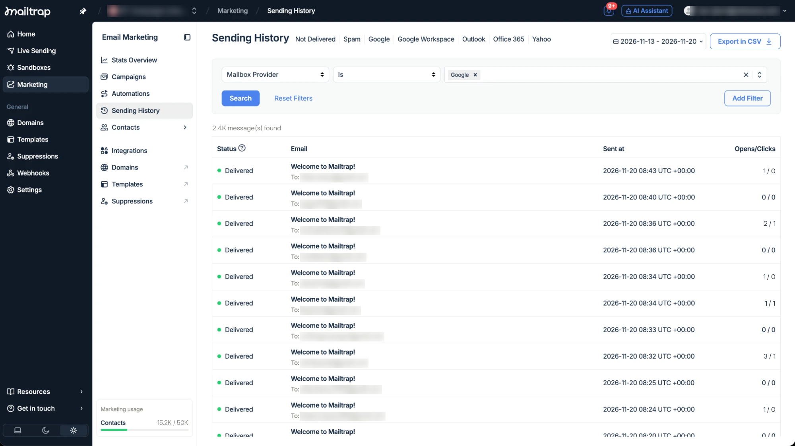
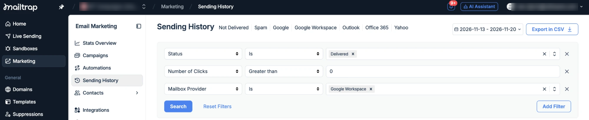
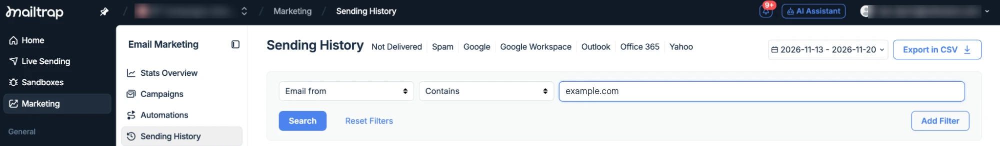
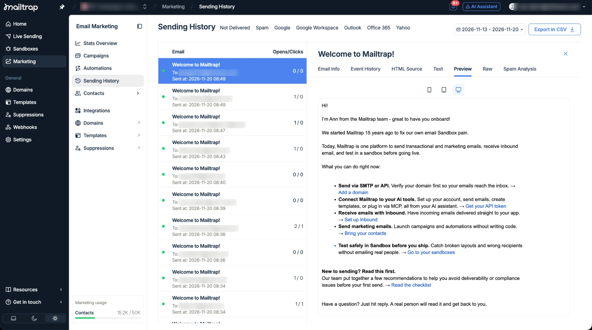
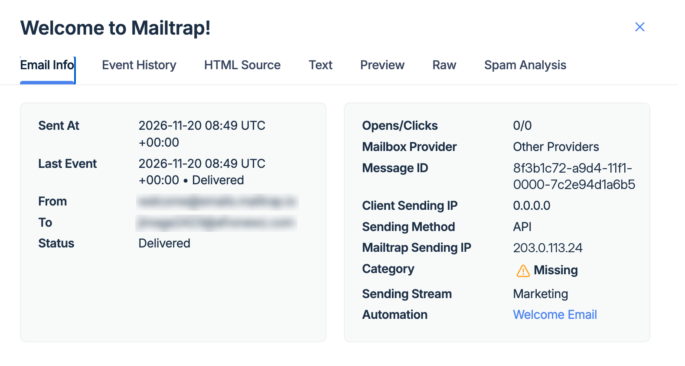

# Sending History

It's a place to view all the emails sent by your Email Marketing campaigns and automations, along with their corresponding details. These include the status of each message, its preview, event history, HTML source, and spam analysis.

### How to use filters in Sending History

To Sending History, go to **Email Marketing** → **Sending History**.

<figure><figcaption></figcaption></figure>

By default, you will see all emails you've sent up until the last 3, 5 or 30 days, depending on your [pricing plan](https://mailtrap.io/pricing/?tab=email-marketing).

To narrow down the Sending History, you can use the filters, which allow you to find:

* **Not Delivered** – All emails that were not accepted by the recipient's mailbox provider (for any reason).
* **Spam** – All emails that were reported as spam by the recipients (this does not include emails that landed in the recipients' spam folders).
* **Google** – All emails that were sent to free Gmail accounts.
* **Google Workspace** – All emails sent to mailboxes using Google Workspace, the paid version of Gmail used by businesses and organizations.
* **Outlook** – All emails that were sent to Outlook.com mailboxes.
* **Office 365** – All emails that were sent to Office 365 mailboxes.
* **Yahoo** – All emails that were sent to Yahoo mailboxes.


When an email is sent, Mailtrap doesn't yet know which Mailbox Provider (e.g., Google, Outlook, Hotmail, etc.) it sent a message to. It's only able to determine this when it receives a response from the recipient's Mailbox Provider, which may sometimes take a few minutes.


### Understanding the filters

If you prefer to set up your filters manually, here's what you can filter by:

| Criteria                   | What is it?                                                                                                                                                                                                   | Example operator and value                                          |
| -------------------------- | ------------------------------------------------------------------------------------------------------------------------------------------------------------------------------------------------------------- | ------------------------------------------------------------------- |
| Email to                   | Email address of a recipient, the To: header of a message.                                                                                                                                                    | Is: john.doe@example.com                                            |
| Email from                 | Email address a message is sent from, the From: header of a message.                                                                                                                                          | Is: newsletter@example.com                                          |
| Subject                    | Subject line of a message. The value is not case-sensitive.                                                                                                                                                   | Contains: Black Friday                                              |
| Status                     | The current state of an email.                                                                                                                                                                                | Is: Delivered, Not delivered, Enqueued, Opted Out                   |
| Date of sending            | The date an email was sent.                                                                                                                                                                                   | Between: 2026-11-01 and 2026-11-15                                  |
| Events                     | An action that occurred to an email before, during, or after delivery. An email can have multiple events associated with it.                                                                                  | Include: Delivery, Open, Click                                      |
| Subscription Topics        | The Subscription Topic a recipient unsubscribed from through this email.                                                                                                                                      | Unsubscribed from: Promotions                                       |
| Number of Clicks           | The total count of clicks that links in an email received. Click tracking must be enabled for clicks to be counted.                                                                                           | Greater than: 3                                                     |
| Number of Opens            | The total number of times that an email was opened. Some mailbox providers, browsers, or extensions can block tracking, which will affect the results. Open tracking must be enabled for opens to be counted. | Is: 2                                                               |
| Mailtrap Sending IP        | IP that Mailtrap used to send an email.                                                                                                                                                                       | Is not: 34.193.89.247                                               |
| Bounce message data        | The response Mailtrap received when an email failed to be delivered or when a soft bounce was recorded.                                                                                                       | Contains: The email account that you tried to reach does not exist. |
| Bounce category            | The type of bounce, based on the response from the recipient's mailbox provider.                                                                                                                              | Is: Bad recipient                                                   |
| Mailbox Provider           | The name of the recipient's mailbox provider. Available once an email is delivered or a response about a failed delivery is received.                                                                         | Is: Proton Mail                                                     |
| Mailbox Provider MX Record | The name of the recipient's mailbox provider, as specified in their MX record.                                                                                                                                | Contains: gmail-smtp-in.l.google.com                                |
| Domains                    | The sending domain an email was sent from.                                                                                                                                                                    | Is: example.com                                                     |

You can combine different filters by using the Add Filter button to the right. In some fields, you may add multiple values to find emails matching either of them.

<figure><figcaption></figcaption></figure>

For example, here, we search for emails that were delivered or clicked, and the recipient has either a Google Workspace or Yahoo! mailbox.

**Sending History** stores emails sent from all your domains. If you wish to filter only for a particular domain or address, use Email from. For example:

<figure><figcaption></figcaption></figure>

### Diving deeper into Sending History

Sending History provides much more information about each sent message. To access this, click on any of the messages. The message opens on the **Preview** tab, so you can see the email as your recipients received it.

<figure><figcaption></figcaption></figure>

The **Email info** tab provides the basic details of a message, including the timestamps, status, from/to addresses, mailbox provider, and the IPs. It also shows the campaign or automation that sent the email, with a link to it. If you're confused about any of these terms, check our[ Sending Glossary](https://docs.mailtrap.io/email-api-smtp/glossary).

<figure><figcaption></figcaption></figure>

**Event History** offers a list of all the events that have happened to this email since it was sent and until this moment. If a recipient unsubscribed from a Subscription Topic through this email, you'll see an **Unsubscribed from topic** event. The recipient won't get emails assigned to that topic, but they aren't added to your suppression list.

<figure><figcaption></figcaption></figure>

You may know the HTML Source, Text, Raw, and Spam Analysis tabs well from Email Sandbox. Here, you can see the code of your message or check its spam score.

### Exporting Sending History

To export the messages that match your filters, click **Export in CSV**. Mailtrap emails you the CSV file once the export is complete.

### Data retention

The number of days Mailtrap stores Sending History depends on your[ Email Marketing plan](https://mailtrap.io/pricing/), from 3 days up to 30 days. Email bodies are stored for a set number of days on each plan, from 3 up to 15 days, so older messages may show their details without the email content.
