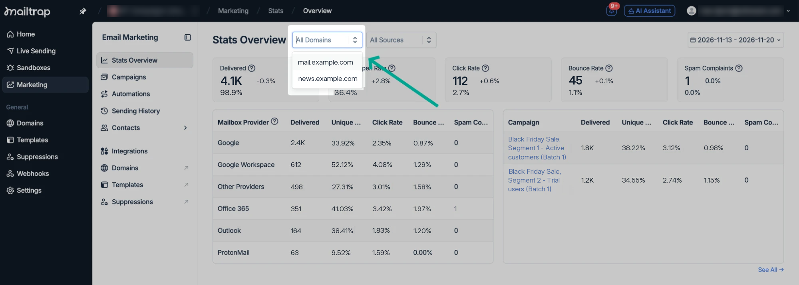
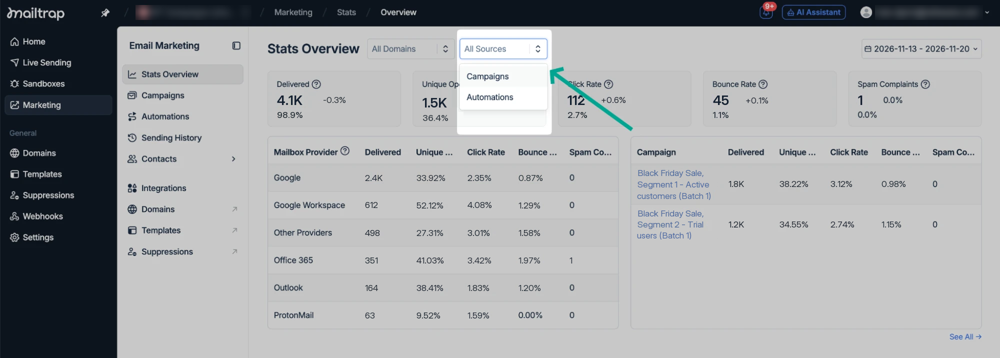
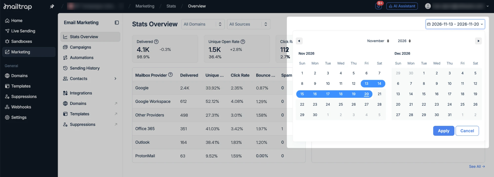
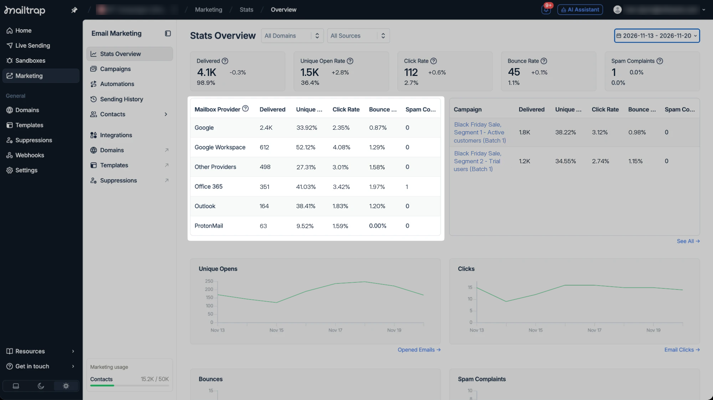
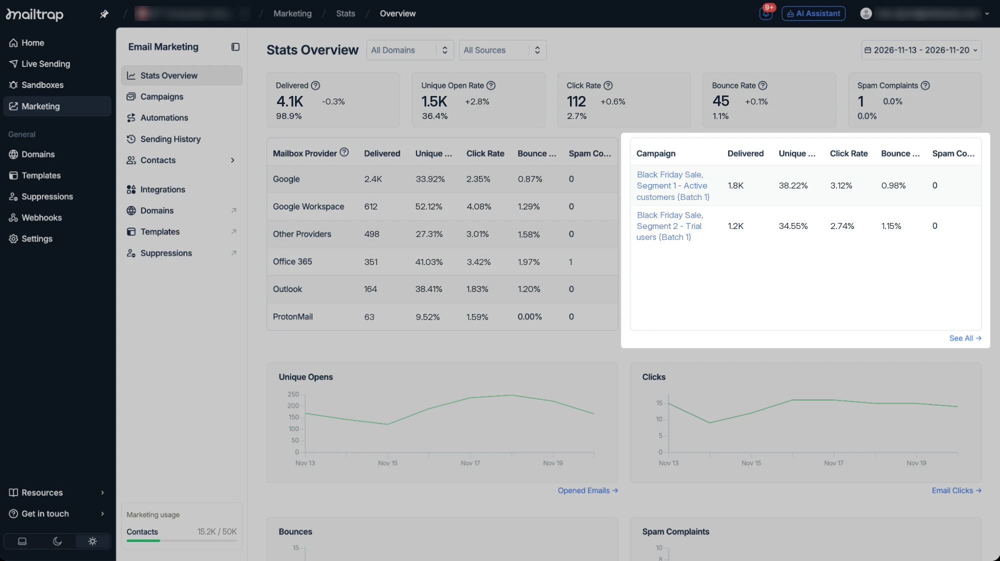
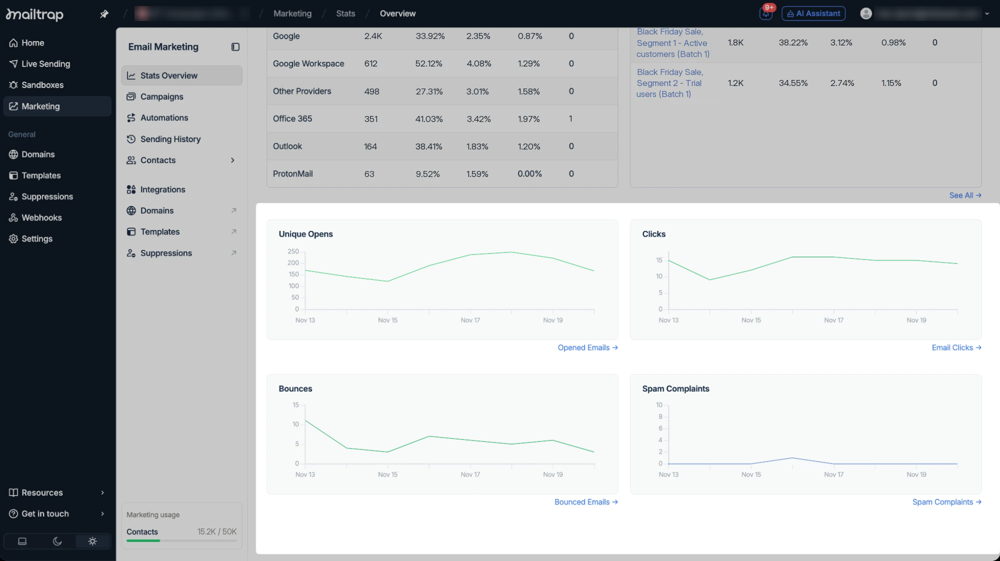
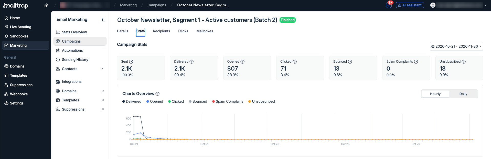

# Stats Overview

Mailtrap provides analytics for all the emails you send with Email Marketing campaigns and automations.&#x20;


The stats for Email Marketing are separate from stats for Live Sending.


On the stats dashboard, you can see the following metrics:

* Delivered emails
* Unique open rate
* Click rate
* Bounce rate
* Spam complaints

### Navigating around the stats dashboard

To open the dashboard, go to **Email Marketing** → **Stats** → **Overview**.

<figure><figcaption></figcaption></figure>

At the top of the page, you'll find a domain selector and a source selector:

* **Domain** – Stats for a particular sending domain.

<figure><figcaption></figcaption></figure>

* **Source** – Stats for **All Sources**, **Campaigns**, or **Automations**.

<figure><figcaption></figcaption></figure>

By default, the stats are shown for the last week + today.

<figure><figcaption></figcaption></figure>

Below the metrics, you'll find:

* **Email Service Provider** – The same metrics for each mailbox provider, such as Gmail, Yahoo, or Outlook.

<figure><figcaption></figcaption></figure>

* **Campaigns** – Your top 6 campaigns for the selected period. Click See All → to open the Campaigns page.&#x20;
  * **Note**: If "Automations" are selected as a source, "Automation" section will be shown here instead of "Campaigns."

<figure><figcaption></figcaption></figure>

* **Daily charts** – Unique opens, clicks, bounces, and spam complaints for each day.

<figure><figcaption></figcaption></figure>

**Note**: To see the stats of a single campaign, navigate to **Marketing** → **Campaigns** and select the campaign you want to see the stats for. You will be taken to the **Campaign Stats** page.

<figure><figcaption></figcaption></figure>

### Thresholds

The thresholds are based on industry standards and, at this point, can't be edited. The current values are:

* For **bounce rate**:
  * 2-5% is a warning level <mark style="color:$warning;">(yellow)</mark>
  * \>5% is a critical level <mark style="color:red;">(red)</mark>
* For **spam rate**:
  * 0.08%-0.1% is a warning level <mark style="color:$warning;">(yellow)</mark>
  * \>0.1% is a critical level <mark style="color:red;">(red)</mark>

### Terminology

#### Sent

Sent refers to the emails attempted to be sent to recipients, including those that may have bounced or not yet been delivered. It's "delivered" + "bounced," and it's used as a base for calculating bounce rate and delivery rate. The other rates (e.g., open rate, click rate etc) are calculated with "Delivered" as a base.

#### Delivered

Delivered refers to the percentage of emails that were accepted by the recipient's mailbox providers compared to all emails sent. An email is counted as delivered when a Delivery event is recorded in its Event History in **Sending History**.


"Delivered" status doesn't mean that a message was viewed or opened by a recipient.&#x20;


Mailtrap will reject an email if a recipient is on a suppression list for a given domain. Read more about [Suppressions](https://docs.mailtrap.io/general/suppressions-list).

#### Unique open rate

Unique open rate refers to the percentage of emails that were opened at least once compared to all delivered emails.

Open tracking needs to be enabled for the domain in question in the [Sending Domains tab](https://mailtrap.io/domains). Only then will email opens be recorded.

<figure><figcaption></figcaption></figure>

#### Click rate

Click rate refers to the percentage of emails that received at least one link click compared to all delivered emails.

When any of the links in an email are clicked, a click event is recorded. The same happens for any further clicks, even if a recipient keeps clicking on the same or different links.

<figure><figcaption></figcaption></figure>


Clock tracking needs to be enabled in the [Tracking settings](https://docs.mailtrap.io/email-live-sending/advanced/tracking-settings-opens-and-clicks-tracking). Additionally, it's not possible to enable it if you're on a free plan.


#### Bounce rate

Bounce rate refers to the percentage of emails dispatched from Mailtrap that were rejected on the recipient's end compared to all emails sent.

Emails may bounce for different reasons, most commonly:

* Invalid email address.
* Rejection by the recipient's mailbox because the email is deemed spam, phishing, etc.
* The security policy of a mailbox provider that rejects emails from all or some domains.
* Permanent connection issue.

#### Spam complaints

Spam complaints refer to the percentage of emails that are reported as spam by recipients, as compared to all emails that were delivered.
