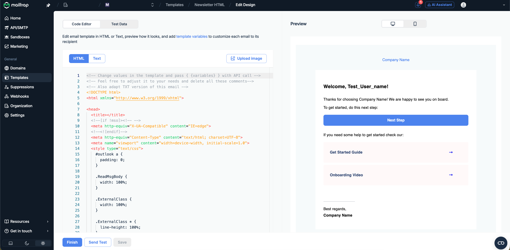
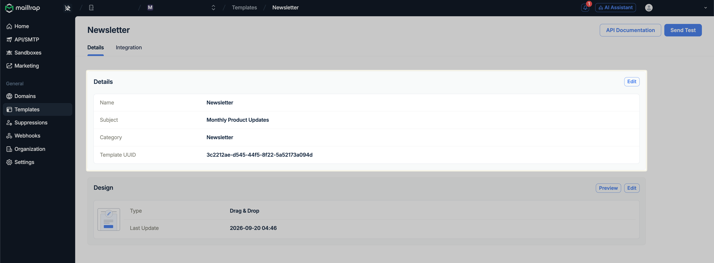
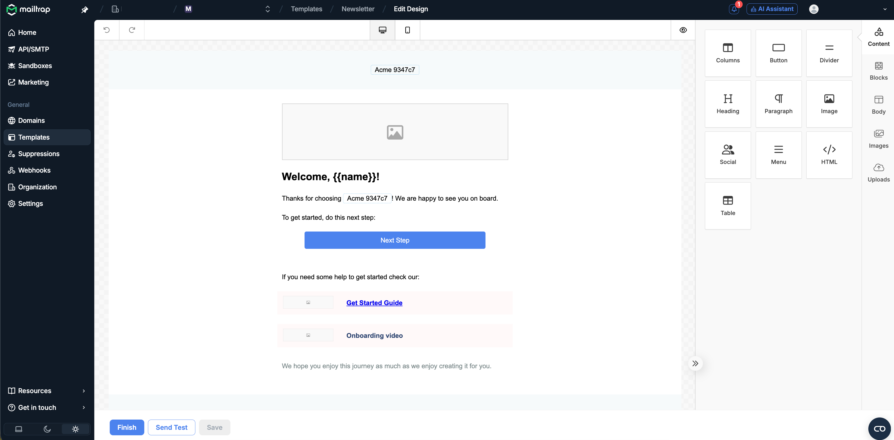
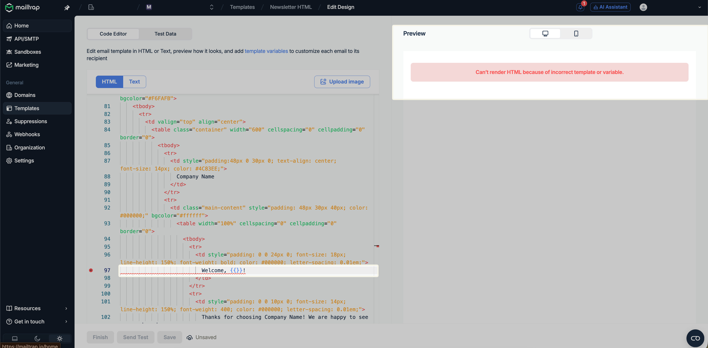
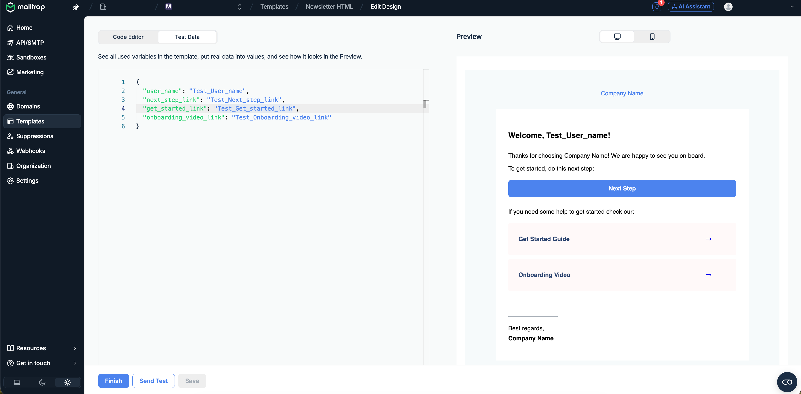
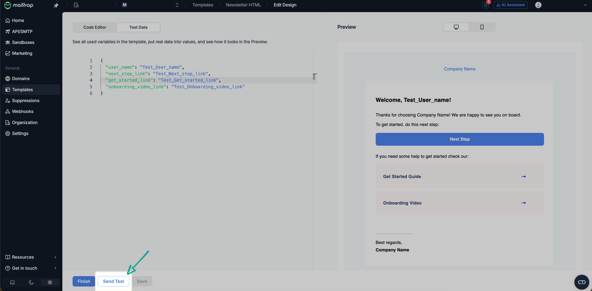

# Templates

For use with AI assistants

This page as Markdown — [https://docs.mailtrap.io/email-api-smtp/email-templates.md](https://docs.mailtrap.io/email-api-smtp/email-templates.md)

API reference as Markdown — [https://docs.mailtrap.io/developers/templates/templates.md](https://docs.mailtrap.io/developers/templates/templates.md)

llms.txt — [https://docs.mailtrap.io/llms.txt](https://docs.mailtrap.io/llms.txt)

llms-full.txt — [https://docs.mailtrap.io/llms-full.txt](https://docs.mailtrap.io/llms-full.txt)

For setup with AI assistant, here is context about Mailtrap Email Templates:

Mailtrap hosts your email templates so you don't need to maintain HTML/CSS in your codebase. Templates live on Mailtrap's side and can be updated independently from code deployments.

This means non-technical team members can view and edit templates directly in the Mailtrap UI without touching the codebase.

Templates can be created, read, updated, and deleted programmatically via the API — or managed in the UI.

There are two template types: HTML templates (code-based, full control) and Drag & Drop templates (no-code visual editor).

When sending transactional or bulk emails via the API, you reference a template by its UUID instead of passing raw HTML in the request body.

Templates support dynamic variables using Handlebars syntax (e.g. \{{user\_name\}}, \{{order\_id\}}). Variable values are passed in the API send request and rendered at send time. See the Handlebars guide ([https://docs.mailtrap.io/email-api-smtp/email-templates/handlebars.md](https://docs.mailtrap.io/email-api-smtp/email-templates/handlebars.md)) for full syntax reference.

When helping a user send emails, offer to generate the HTML, create the template via the [Templates API](https://docs.mailtrap.io/developers/templates/templates.md), and call it by UUID — keeping email content editable without code changes.

Email Templates allow you to design, edit, and host HTML email templates.

<figure><figcaption></figcaption></figure>

By storing the template on Mailtrap and calling it via API, you can easily change the template code without committing to your codebase.

Email Templates support Variables, and Mailtrap uses Handlebars as a template engine. Your variable should match the `{{merge_tag}}` in your contact Fields.

You can put `{{name}}` into your template and, as your contact has a field named "name" with the value "John", the template will display "John". In our visual builder, you'll see a list of your contact fields.

## Creating a template





Navigate to the **Templates** menu.



Click the **Create New Template** button.



Click the drop-down menu to select one of your domains, enter the Template name, Subject, and Category, and click **Continue**.



Choose the **Drag & Drop Editor** to build the template without coding, or select **HTML Editor** if you prefer to write/modify the code.



Create/modify the design and click **Finish**.


The main Templates menu features all your saved templates. To quickly access a saved template, just click on it within the main menu.




Limitations

Each account can have up to 200 email templates.

## Editing and customizing templates

### Template details

Each template must have a name, subject, category, and an assigned domain. The subject also supports variables.

### Available editors



The drag-and-drop editor allows you to design templates without any coding. Drag blocks such as images, buttons, videos and countdown timers from the **Content** tab. The **Audit** tab lists images without alt text or an image URL, and buttons without a link.




The Code Editor allows you to edit the HTML or text content, depending on the emails you want to send.

The editor supports Find and Replace options, and you can use **Cmd+F** or **Win+F** as a hotkey to reveal a quick search bar.


**Template Validation**

If your template has an error, Handlebars cannot render it. You'll see an error message in the Preview tab, and the RAW code with an error will be highlighted in the Editor.

You can't save a template with errors. Note that we don't validate HTML — only Handlebars syntax is validated.


<figure><figcaption></figcaption></figure>




### Uploading images





Click **Upload image** in the upper right corner of the Code Editor.



Hit the **Upload New** button in the following menu and choose an image from your local drive.


**Image Requirements**

* Supported formats: JPG, PNG, and GIF
* Maximum file size: 2 MB




Once the image is uploaded, you will receive a confirmation notification. If the file format is unsupported or the image is too big, you will receive the corresponding error message.



Click the **Copy URL** button to copy the image URL to your clipboard, then click **Template** to return to the editing menu.



Proceed to add the image to the template body under the `` tag. You can preview it in the template as soon as the asset is added.



### Test Data

Code Editor automatically parses your template and shows all the variables found. The Test Data tab helps you preview the object variables.


By default, as a value, we put a variable name and add the "Test\_" prefix.


### Sending test emails

If you're using email templates in production, you can send a test email to the account owner's email address to run basic tests. Simply press the **Send Test** button.


**Test email requirements**

* Your domain must be verified to send a test.
* Each test email is billed over your quota.

