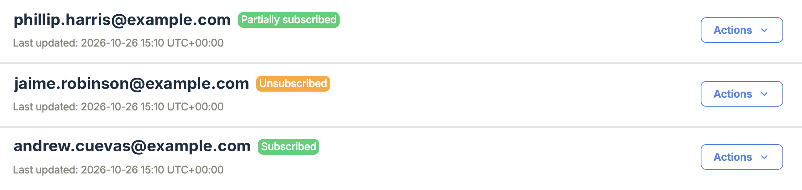

# Subscription Topics (Unsubscribe Groups)

Recipients may want your product updates without receiving every promotion or newsletter. Unsubscribe groups give them that choice: they can opt out of specific email categories while continuing to receive the content they want.

In Mailtrap, this feature is called **Subscription Topics**. You create topics that match the types of marketing emails you send (such as Newsletters, Product updates, or Promotions) and assign one topic to each campaign or automation email.

Recipients can use the **Manage subscriptions** page to update their topic preferences or unsubscribe from all your marketing emails. Their topic preferences apply across both campaigns and automation emails.

### How Subscription Topics work

Each campaign and automation email has one **Subscription Topic**, such as:

* Newsletters
* Product updates
* Promotions
* Events and webinars

You create topics that match the types of emails you send.

When a recipient unsubscribes from a topic, they stop receiving future campaigns and automation emails assigned to that topic from the same sending domain. Their preferences for other topics, and for that topic on your other domains, remain unchanged.

For example, a recipient who unsubscribes from **Promotions** can still receive emails assigned to **Product updates**.

### How to create or edit a topic

To create a topic, navigate to **Unsubscribes** → **Subscription** **Topics** and click Create Topic.

In the dialog:

* **Choose All domains or one sending domain** – A topic assigned to All domains is available to every sending domain on the account, including domains added later.
* **Enter a name** - Shown to recipients on the Manage subscriptions page, in campaign and automation lists, and in Sending History.
  * Names should be up to 255 characters and must be unique within the account, even if they use different domains. Capitalization is ignored, and leading and trailing spaces are removed.
* **Optionally, enter a description** (up to 500 characters) - Shown to recipients on the Manage subscriptions page.

To edit an existing topic, find it on the Subscription Topics page, click Edit topic, update its details, and click Save. You cannot change its domain if doing so would exclude campaigns or automations already using it.

### How to assign Subscription Topics

You can also create a topic from the **Subscription topic** field when setting up a campaign or automation email. The new topic is selected automatically if it is available for that email’s sending domain.


A duplicated campaign or automation keeps its topics if they are still non-deleted and available for the copy’s sending domains. Otherwise, the copied email has no topic. Select an available topic before sending the campaign or turning on the automation.


#### Assign topics to campaigns

Each campaign needs one Subscription Topic before it can send.

On the campaign’s **Details** step, choose **Subscription** topic next to the subject. Available options include non-deleted topics assigned to the campaign’s sending domain or to all domains.

If you change the sending domain and the selected topic is no longer available, the selection is cleared. Choose another topic before continuing.

#### Assign topics to automation emails

Each **Send Email** step has its own topic, selected alongside the subject. Different emails within the same automation can use different topics.

Each step containing an email must have a non-deleted topic available for its sending domain. Otherwise, the step is invalid and the automation cannot be turned on. A step without an email does not require a topic.


You can also change topics while an automation is active or paused.


When an automation is disabled, a topic that still matches the step’s domain remains locked. You can replace it if it is missing, deleted, or unavailable for that domain, so the automation can be turned on again.

The **Automations** page shows the topics used by each automation in a separate column.

### How recipients manage their preferences

The Unsubscribe link in a marketing email opts the recipient out of all marketing emails from the domain, regardless of the email’s Subscription Topic. To change individual topic preferences, recipients use Manage subscriptions.

When at least two topics are available for the email’s sending domain, the footer can also include a **Manage subscriptions** link. This opens a page where recipients can choose which topics they want to receive and click Save to confirm their preferences.&#x20;

The Manage subscriptions page displays topic names and descriptions. Recipients can:

* Unsubscribe from individual topics.
* Subscribe to previously unsubscribed topics again.
* Unsubscribe from all marketing emails.

| **Action**                                                 | **Result**                                                                                                                                |
| ---------------------------------------------------------- | ----------------------------------------------------------------------------------------------------------------------------------------- |
| Unsubscribe from some topics                               | The recipient remains subscribed overall and is not added to Suppressions. They can receive other topics, including topics created later. |
| Unsubscribe from every topic they were still subscribed to | Treated as a full unsubscribe. The recipient is added to Suppressions and does not receive topics created later.                          |
| Unsubscribe from all marketing emails                      | The recipient is added to Suppressions and stops receiving marketing emails.                                                              |

Mailtrap checks unsubscribe preferences at send time, including for previously scheduled campaigns.

Topic preferences apply across campaigns and automation emails, and belong to the sending domain. For example, opting out of Promotions through an email from one domain excludes the recipient from future campaigns and automation emails assigned to that topic and sent from that domain. Emails of that topic from your other domains still reach them.


Default Mailtrap email templates now include the **Manage subscriptions** link. However, campaigns and automations created using earlier template versions, and your own templates are not updated automatically. To add the link, manually edit their content and select **Manage** **subscriptions** from the editor’s link options. In HTML, use **\_\_manage\_subscriptions\_url\_\_** as the link destination.


#### How to check unsubscribe activity

You can check unsubscribes in three places:

* **Unsubscribes** → **Suppressions**: See recipients who fully unsubscribed, either by choosing to unsubscribe from all marketing emails or by opting out of all topics.
* **Contacts**: Check each contact’s status. A contact who opts out of some topics is shown as **Partially subscribed**. A contact who opted out from all topics or unsubscribes from all marketing emails is shown as **Unsubscribed**.

<figure><figcaption></figcaption></figure>

* **Sending History**: Filter unsubscribe events by topic, such as Newsletters, to see which recipients unsubscribed and which emails they used to do so.

<figure><figcaption></figcaption></figure>

### How to delete a topic

To delete a Subscription Topic, navigate to Unsubscribes → Subscription Topics and click a bin icon near the selected topic.&#x20;

Please note, a topic still being in use by campaign or automation that can still send cannot be deleted. This includes:

* Draft, scheduled, sending, paused, or under-review campaigns.
* Active or paused automations.

Assign them another topic, then try again.

Finished campaigns and disabled automations do not block deletion. They still count in **Campaigns used** and **Automations used**, so a topic can show usage and still be deletable.

#### What happens after deletion?

Deleting a topic does not change its existing campaign or automation assignments. The topic remains displayed there with a **Deleted** badge.

A deleted topic:

* Cannot be assigned to another email.
* Cannot be edited or restored.
* Remains on the Subscription Topics page for 30 days, then disappears from the list.
* Has a name that can be reused by a new topic.

A new topic with the same name does not inherit the old topic’s preferences. Recipients who unsubscribed only from the deleted topic are subscribed to the new one. Full unsubscribes still apply.

A draft campaign or disabled automation referencing a deleted topic must be assigned an available topic before it can send or be turned on. An active automation referencing a deleted topic cannot be saved until the affected step has an available topic for its domain.

### Existing accounts and the General topic

When Subscription Topics is enabled for an existing account, existing campaigns and automation emails are assigned to **General**, which is available for all domains.

Disabled automations are excluded from this automatic assignment. Choose topics for their emails before enabling them again.

Eligible account users receive an in-app notification and an email titled “Review your new subscription topic assignments”, with links to Campaigns and Automations.

Review the assignments and either rename **General** or create more specific topics. A recipient who unsubscribes from **General** stops receiving every marketing email still assigned to it.

### Use cases

Some of the most common use cases include:

* **Separate promotions from useful content** – A subscriber opts out of offers but continues receiving tutorials and product updates.
* **Offer several newsletters** – A company sends technical and business newsletters. Recipients can unsubscribe from either independently.
* **Manage event communication** – Someone stops receiving webinar invitations while keeping their regular newsletter subscription.
* **Respect preferences across sending flows** – A recipient unsubscribes from Promotions and is excluded from both promotional campaigns and automation emails using that topic.
* **Support multiple sending domains** – A customer creates domain-specific topics for different brands, alongside shared topics available across all sending domains.
* **Investigate unsubscribe activity** – A support or marketing team checks current preferences on a contact and reviews topic-unsubscribe events in Sending History.

### Additional notes:

* Topics belong to one account and are not shared across accounts in an organization.
* There is no separate limit on the number of topics per account.
* Each campaign has one topic. Each automation Send Email step has one topic.
* Topics apply only to Email Marketing campaigns and automation emails. Live Sending does not use them.
* The public API also supports creating topics, assigning them, or returning per-topic unsubscribe preferences, as well as unsubscribing a user from a specific topic.
